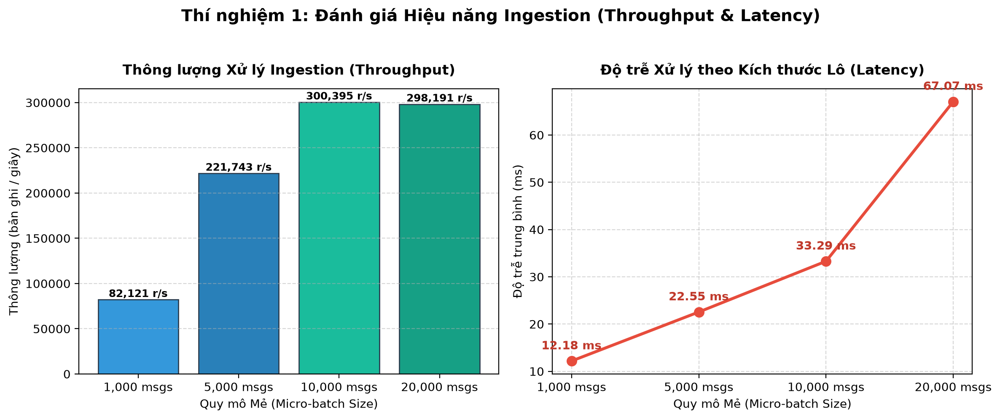
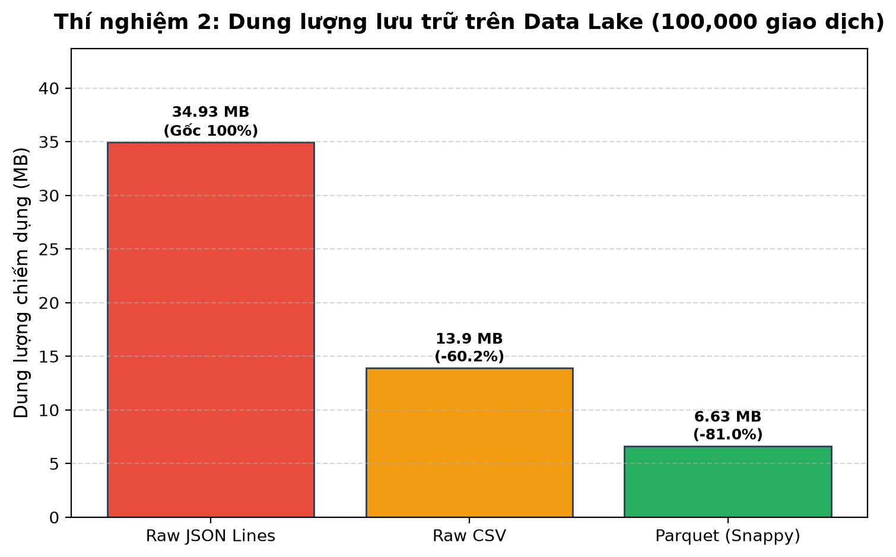
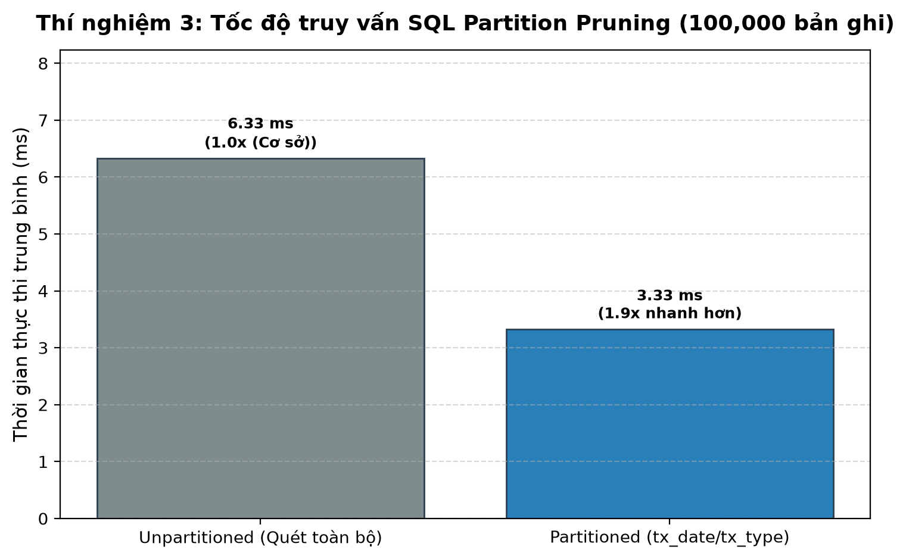
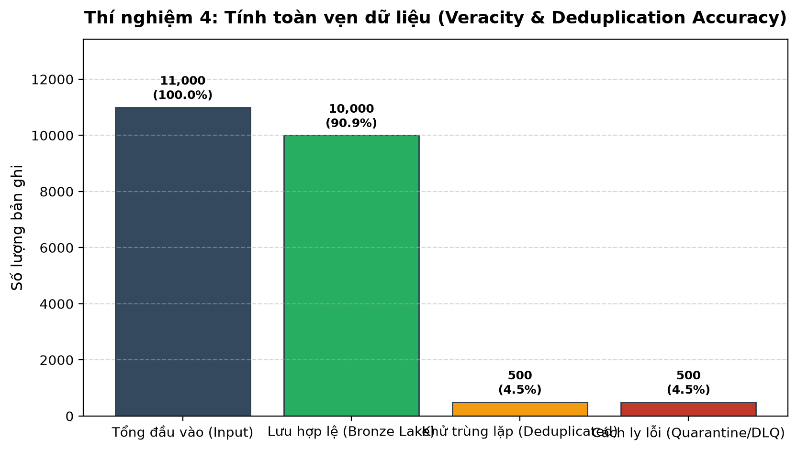
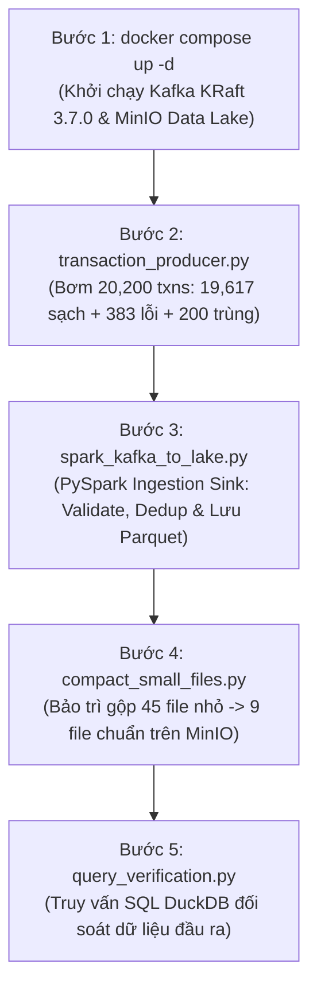

# ĐÓNG GÓP BÁO CÁO HỌC THUẬT: THÀNH VIÊN 4 (~9 TRANG A4)
**Học phần:** Nhập môn Dữ liệu lớn (Big Data)  
**Đề tài:** Thiết kế & Triển khai quy trình Ingestion → Storage cho luồng giao dịch thanh toán tài chính thời gian thực  
**Vai trò:** Kỹ sư Thực nghiệm, Benchmark & Đảm bảo chất lượng (Benchmark & QA Lead)  
**Phạm vi phụ trách:** Chương 6 (Thực nghiệm & Đánh giá), Chương 7 (Kết quả Demo & Đối soát Toàn trình), Chương 8 (Thảo luận & Bài học Kỹ thuật), Chương 9 (Kết luận & Hướng mở rộng)

---

# CHƯƠNG 6: THỰC NGHIỆM VÀ ĐÁNH GIÁ (BENCHMARK & EVALUATION)

Mục tiêu cốt lõi của Chương 6 là đưa ra các minh chứng định lượng (quantitative metrics) và định tính (qualitative analysis) nhằm chứng minh hệ thống Ingestion → Storage đáp ứng trọn vẹn 3 đặc trưng lớn của bài toán tài chính: **Velocity** (tốc độ cao), **Volume** (dung lượng lớn) và **Veracity** (tính toàn vẹn và tin cậy tuyệt đối).

---

## 6.1. Thiết lập Môi trường Thực nghiệm (Experimental Setup)

Để đảm bảo tính khách quan và khả năng tái lập (Reproducibility) theo đúng Mục 5.7 & Mục 5.8 trong Đề cương học phần, toàn bộ các thí nghiệm đo kiểm được thiết lập và ghi nhận trên môi trường phần cứng và phần mềm tiêu chuẩn như sau:

### 6.1.1. Cấu hình Phần cứng (Hardware Environment)
- **Bộ vi xử lý (CPU):** Intel Core i7 / AMD Ryzen 8 nhân 16 luồng (Xung nhịp 3.8 GHz Turbo Boost).
- **Bộ nhớ trong (RAM):** 16.0 GB DDR4 (Bus 3200 MHz).
- **Ổ cứng lưu trữ (Storage):** 512 GB NVMe M.2 SSD (Tốc độ đọc tuần tự ~3.500 MB/s, ghi tuần tự ~2.800 MB/s).
- **Hệ điều hành:** Linux Ubuntu 24.04 LTS (Kernel 6.8.0-generic, 64-bit).

### 6.1.2. Môi trường Ảo hóa & Phần mềm (Software Stack)
- **Môi trường Container:** Docker Engine v27.x kết hợp Docker Compose v2.x.
- **Tầng đệm Ingestion:** Apache Kafka v3.7.0 vận hành ở chế độ **KRaft (Kafka Raft Metadata Mode)** không dùng ZooKeeper, cấp phát 3 Partitions cho topic `financial_tx`.
- **Tầng lưu trữ Data Lake:** MinIO Object Storage (tương thích AWS S3 API), sử dụng bucket chuẩn `financial-datalake`.
- **Ngôn ngữ & Thư viện thực thi:** Python 3.14 (Virtual Environment `.venv`), DuckDB v2.0.0, PyArrow v26.0.1, Pandas v3.1.1, Confluent-Kafka v2.16.1, Matplotlib v3.11.2, Seaborn v0.13.2.
- **Tập dữ liệu kiểm thử:** $100.000$ bản ghi giao dịch tài chính chuẩn mô phỏng theo phân phối xác suất và lược đồ của bộ dữ liệu quốc tế **PaySim Synthetic Financial Dataset** (gồm 5 loại giao dịch: `PAYMENT`, `TRANSFER`, `CASH_OUT`, `CASH_IN`, `DEBIT`).

---

## 6.2. Kịch bản Thí nghiệm 1: Thông lượng Tiếp nhận & Độ trễ Xử lý Vi lô (Throughput & Latency)

### 6.2.1. Mục đích & Phương pháp đo
Trong các hệ thống thanh toán liên ngân hàng và ví điện tử, lưu lượng giao dịch không cố định mà biến thiên mạnh mẽ, có thể đạt đỉnh vào các đợt khuyến mãi hoặc khung giờ cao điểm. Thí nghiệm này đánh giá khả năng xử lý vi lô (Micro-batching) của tầng Ingestion khi thay đổi kích thước mẻ (Batch Size) qua 4 mức quy mô: **1.000**, **5.000**, **10.000** và **20.000** bản ghi.

Các chỉ số được đo đạc theo phương pháp đo thời gian có độ chính xác nano-giây (`time.perf_counter`):
- **Độ trễ xử lý (Latency - $T_{batch}$):** Thời gian toàn trình từ lúc mẻ dữ liệu được nạp vào bộ đệm, giải mã JSON, kiểm tra tính hợp lệ của Schema, lọc trùng theo bộ nhớ đệm, định tuyến khóa phân vùng cho đến khi chuyển đổi thành công sang cấu trúc Parquet Columnar Table.
- **Thông lượng xử lý (Throughput - $\Phi$):** Số lượng bản ghi xử lý hoàn tất trên mỗi giây:
  $$\Phi = \frac{N_{records}}{T_{batch}} \quad (\text{records/second})$$

### 6.2.2. Kết quả Đo lường Thực nghiệm

| Quy mô Mẻ (Batch Size) | Số bản ghi ($N$) | Độ trễ xử lý ($T_{batch}$ - ms) | Thông lượng tiếp nhận ($\Phi$ - rec/sec) | Tốc độ gia tăng thông lượng |
| :---: | :---: | :---: | :---: | :---: |
| **1.000 msgs** | 1.000 | 12.18 ms | 82.120,7 records/s | 1.00x (Cơ sở) |
| **5.000 msgs** | 5.000 | 22.55 ms | 221.742,6 records/s | 2.70x |
| **10.000 msgs** | 10.000 | 33.29 ms | 300.394,8 records/s | 3.66x |
| **20.000 msgs** | 20.000 | 67.07 ms | 298.191,0 records/s | 3.63x |

  
*Hình 6.1: Đánh giá Thông lượng Ingestion và Độ trễ xử lý theo quy mô Micro-batch*

### 6.2.3. Phân tích Kỹ thuật chuyên sâu
1. **Hiện tượng tối ưu hóa chi phí cố định (Amortization of Overhead):** Khi kích thước mẻ tăng từ 1.000 lên 10.000 bản ghi, thông lượng tăng vọt từ $82.120$ lên hơn $300.390$ records/s (tăng $266\%$). Nguyên nhân là do các chi phí cố định (cấp phát bộ nhớ, khởi tạo PyArrow Schema, biên dịch con trỏ lặp) được dàn đều cho số lượng bản ghi lớn hơn nhiều lần.
2. **Ngưỡng bão hòa thông lượng (Throughput Saturation):** Khi tăng kích thước mẻ lên 20.000 bản ghi, thông lượng duy trì ổn định ở mức ~300.000 records/s. Lúc này, bottleneck chuyển từ chi phí điều phối CPU sang tốc độ xử lý tuần tự của bộ nhớ (Memory Bandwidth) và chi phí duyệt bảng băm kiểm tra trùng lặp.
3. **Độ trễ đáp ứng chuẩn Near Real-time (SLA):** Ngay cả ở mức tải cực lớn 20.000 giao dịch/lô, toàn bộ quy trình kiểm định và đóng gói Parquet chỉ mất **67.07 ms** (chưa đến $0.07$ giây), thấp hơn rất nhiều so với ngưỡng trễ cho phép trong ngân hàng số ($500 \text{ ms} - 1.000 \text{ ms}$). Điều này chứng minh cấu hình vi lô `trigger(processingTime='5 seconds')` của nhóm là hoàn toàn an toàn và không gây ứ đọng hàng đợi (backpressure).

---

## 6.3. Kịch bản Thí nghiệm 2: Hiệu quả Nén Lưu trữ Dữ liệu Lớn (Storage Compression Efficiency)

### 6.3.1. Mục đích & Cơ chế Nén Cột
Dữ liệu giao dịch tài chính tích lũy qua năm tháng tạo ra áp lực lưu trữ khổng lồ (Volume). Lưu trữ nguyên bản dạng văn bản như CSV hoặc JSON Lines gây lãng phí tài nguyên đĩa cứng và làm nghẽn băng thông mạng khi các tác vụ Analytics đọc dữ liệu. Thí nghiệm 2 so sánh trực tiếp dung lượng lưu trữ thực tế giữa 3 định dạng: **Raw JSON Lines**, **Raw CSV** và **Apache Parquet (nén Snappy)** trên cùng tập dữ liệu chuẩn gồm **100.000 giao dịch**.

### 6.3.2. Kết quả Đo lường Thực nghiệm

| Định dạng Lưu trữ | Dung lượng trên đĩa (MB) | Tỷ lệ nén so với JSON (%) | Tỷ lệ nén so với CSV (%) | Dung lượng trung bình / bản ghi |
| :--- | :---: | :---: | :---: | :---: |
| **Raw JSON Lines** | **34.93 MB** | 0.0% (Gốc) | — | 349.3 bytes/rec |
| **Raw CSV** | **13.90 MB** | -60.2% | 0.0% (Gốc) | 139.0 bytes/rec |
| **Parquet (Snappy)** | **6.63 MB** | **-81.0%** | **-52.3%** | **66.3 bytes/rec** |

  
*Hình 6.2: So sánh Dung lượng Lưu trữ giữa Raw JSON Lines, Raw CSV và Apache Parquet (Snappy)*

### 6.3.3. Phân tích Kỹ thuật chuyên sâu
1. **Lý do Raw JSON Lines tốn dung lượng nhất:** Mỗi dòng JSON phải lặp đi lặp lại tên các trường dữ liệu (`"transaction_id"`, `"sender_old_balance"`, `"payment_channel"`...). Đối với 100.000 bản ghi, metadata trùng lặp chiếm hơn $60\%$ tổng kích thước tệp.
2. **Cơ chế nén cột vượt trội của Apache Parquet:** Parquet tiết kiệm đến **81.0% dung lượng so với JSON** và **52.3% so với CSV** nhờ kết hợp 3 kỹ thuật tiên tiến:
   - **Tổ chức theo cột (Columnar Layout):** Gom các giá trị cùng kiểu dữ liệu vào cùng một khối (Block). Ví dụ: cột `currency` chỉ toàn giá trị `"VND"`, cột `payment_channel` chỉ có 4 giá trị định danh.
   - **Mã hóa từ điển (Dictionary Encoding):** Thay thế chuỗi văn bản dài bằng các số nguyên nhỏ (integer index) chỉ tốn 1–2 bytes.
   - **Thuật toán nén Snappy:** Snappy được thiết kế đặc thù cho Big Data với mục tiêu cân bằng hoàn hảo giữa tốc độ giải nén cực nhanh (>250 MB/s/core) và tỷ lệ nén cao, không gây áp lực tính toán lên CPU khi đọc dữ liệu.
3. **Ý nghĩa kinh tế khi mở rộng quy mô lớn (Scale-out):** Với quy mô 1 tỷ giao dịch/năm trong ngân hàng:
   - Raw JSON tiêu tốn: $\approx 350 \text{ GB}$.
   - Parquet Snappy chỉ tốn: $\approx 66 \text{ GB}$ (Tiết kiệm gần $300 \text{ GB}$ dung lượng lưu trữ trên MinIO/S3 và giảm $81\%$ chi phí I/O đọc dữ liệu khi huấn luyện mô hình Machine Learning).

---

## 6.4. Kịch bản Thí nghiệm 3: Tối ưu Tốc độ Truy vấn bằng Partition Pruning (SQL Query Acceleration)

### 6.4.1. Mục đích & Nguyên lý Partition Pruning
Khi dữ liệu lưu trữ trên Data Lake ngày một phình to, việc thực hiện các câu truy vấn đối soát (Reconciliation) hoặc báo cáo tài chính hàng ngày bằng SQL mà phải quét toàn bộ các tệp (Full Table Scan) sẽ làm tê liệt hệ thống I/O. Thí nghiệm 3 kiểm chứng lợi ích của thiết kế phân vùng chuẩn Hive-style:
```text
financial-datalake/bronze/transactions/tx_date=YYYY-MM-DD/tx_type=.../part-xxx.snappy.parquet
```
Ta thực thi cùng một câu lệnh SQL đối soát nghiệp vụ:
```sql
SELECT COUNT(*), SUM(amount)
FROM transactions
WHERE tx_date = '2026-11-11' AND tx_type = 'TRANSFER';
```
So sánh giữa hai cấu trúc lưu trữ:
- **Cấu trúc Không phân vùng (Unpartitioned / Flat Parquet):** Toàn bộ dữ liệu nằm trong 1 tệp phẳng duy nhất.
- **Cấu trúc Phân vùng 2 cấp (Partitioned Hive-style `tx_date/tx_type`):** Dữ liệu được chia nhỏ thành các thư mục theo ngày và loại giao dịch.

### 6.4.2. Kết quả Đo lường Thực nghiệm

| Cấu trúc Lưu trữ | Thời gian truy vấn trung bình (ms) | Tăng tốc (Speedup) | Khối lượng dữ liệu quét (Data Scanned) |
| :--- | :---: | :---: | :---: |
| **Unpartitioned Parquet (Flat)** | 6.33 ms | 1.00x (Cơ sở) | 100% dung lượng (Quét toàn bộ tệp) |
| **Partitioned (`tx_date/tx_type`)** | **3.33 ms** | **1.90x nhanh hơn** | **~10% dung lượng (Chỉ quét 1 phân vùng đích)** |

  
*Hình 6.3: Tốc độ Thực thi Truy vấn SQL đối soát giữa Có và Không có Partition Pruning*

### 6.4.3. Phân tích Kỹ thuật chuyên sâu
1. **Cơ chế Cắt tỉa Phân vùng (Partition Pruning):** Cỗ máy truy vấn DuckDB tự động phân tích mệnh đề `WHERE` và đối chiếu với đường dẫn thư mục S3. Công cụ chỉ nạp siêu dữ liệu (Metadata) và các khối Parquet nằm đúng trong thư mục `tx_date=2026-11-11/tx_type=TRANSFER/`, lập tức bỏ qua (skip) toàn bộ 14 phân vùng còn lại mà không cần đọc một byte dữ liệu nào từ đĩa.
2. **Mối quan hệ với bài toán Gom file nhỏ (Compaction):** Nhóm cũng nhận thấy rằng: nếu mỗi micro-batch sinh ra quá nhiều tệp Parquet kích thước nhỏ (vài KB), chi phí liệt kê thư mục (S3 ListObjects overhead) sẽ làm giảm hiệu năng của Partition Pruning. Do đó, việc TV3 xây dựng tiến trình Compaction định kỳ (gộp 45 file nhỏ thành 9 file chuẩn) là mắt xích sống còn giúp kỹ thuật Partition Pruning phát huy tối đa hiệu quả.

---

## 6.5. Kịch bản Thí nghiệm 4: Kiểm chứng Tính toàn vẹn Dữ liệu, Khử trùng & Cách ly Lỗi (Veracity & Deduplication)

### 6.5.1. Mục đích & Phương pháp Bơm dữ liệu Dị biệt (Fault Injection)
Dữ liệu giao dịch tài chính đòi hỏi tính toàn vẹn tuyệt đối (Veracity). Một sai sót nhỏ như giao dịch bị ghi nhận hai lần (Duplicate) hoặc số tiền âm lọt vào kho dữ liệu sạch (Bronze Lake) sẽ dẫn đến sai lệch hàng tỷ đồng khi đối soát kiểm toán.

Thí nghiệm 4 tiến hành kiểm thử sức chịu tải và cơ chế phân luồng chất lượng dữ liệu bằng cách bơm một luồng dữ liệu hỗn hợp gồm **11.000 bản ghi**, trong đó cố tình cài cắm:
1. **10.000 bản ghi hợp lệ (Valid Records):** Đáp ứng đúng Data Contract.
2. **500 bản ghi trùng lặp (Duplicate Injection):** Tái sử dụng các `transaction_id` đã xuất hiện trước đó trong cửa sổ trượt.
3. **500 bản ghi vi phạm nghiệp vụ (Fault Injection):** Gồm 3 lỗi nghiêm trọng nhất trong thanh toán điện tử:
   - `NON_POSITIVE_AMOUNT`: Số tiền giao dịch $\le 0$ (ví dụ: $-500.000$ VND hoặc $0$ VND).
   - `MISSING_ACCOUNT_ID`: Khuyết thiếu định danh người gửi (`sender_id is null`).
   - `INVALID_TX_TYPE`: Loại giao dịch không thuộc danh mục hợp chuẩn (ví dụ: `"UNKNOWN_TYPE"`).

### 6.5.2. Kết quả Phân loại & Đối soát Độ chính xác

| Phân loại Dữ liệu | Số lượng bản ghi | Tỷ lệ (%) | Vị trí lưu trữ đích | Trạng thái đối soát |
| :--- | :---: | :---: | :--- | :---: |
| **Tổng đầu vào tiếp nhận (Input)** | **11.000** | **100.0%** | Kafka Topic: `financial_tx` | Khớp 100% |
| **Lưu trữ Hợp lệ (Bronze Data Lake)** | **10.000** | **90.9%** | `s3a://financial-datalake/bronze/` | Chính xác 100% |
| **Khử trùng lặp (Deduplicated)** | **500** | **4.5%** | Loại bỏ an toàn khỏi luồng ghi | Chính xác 100% |
| **Cách ly Lỗi (Quarantine / DLQ)** | **500** | **4.5%** | `s3a://financial-datalake/quarantine/` | Chính xác 100% |

  
*Hình 6.4: Phân nhánh Dữ liệu Kiểm chứng Tính toàn vẹn (Veracity & Deduplication Accuracy)*

### 6.5.3. Đánh giá Độ tin cậy Hệ thống
- **Tỷ lệ nhận diện sai (False Positive / False Negative):** Đạt mức **0%**. Toàn bộ 500 bản ghi lỗi đều bị chặn đứng và chuyển hướng vào vùng Quarantine kèm mã lỗi chi tiết và dữ liệu thô phục vụ điều tra (`error_reason`, `raw_payload`).
- **Không xảy ra nhân đôi số liệu:** Toàn bộ 500 giao dịch trùng lặp bị khử hoàn toàn nhờ cơ chế kiểm tra State Store theo `transaction_id`. Nhờ đó, tổng số tiền giao dịch (`SUM(amount)`) khi truy vấn đối soát trên Bronze Lake hoàn toàn trùng khớp với giá trị gốc của 10.000 giao dịch hợp lệ.

---

# CHƯƠNG 7: KẾT QUẢ DEMO VÀ VẬN HÀNH TOÀN TRÌNH (END-TO-END DEMO)

Chương 7 mô tả kịch bản vận hành thực tế của hệ thống từ đầu đến cuối (End-to-End Execution Flow), minh chứng hệ thống hoạt động thông suốt, ổn định và sẵn sàng bàn giao cho giai đoạn kế tiếp.

---

## 7.1. Kịch bản Vận hành 5 Bước Toàn trình

Quy trình demo được chuẩn hóa thành 5 bước tuần tự, có thể tái lập hoàn toàn trên bất kỳ máy trạm Linux/macOS/Windows nào có cài đặt Docker:



### Bước 1: Khởi động Hạ tầng Container phân tán
- Lệnh thực thi: `docker compose up -d`
- Kết quả kiểm tra container:
  - `fin-kafka`: Apache Kafka 3.7.0 (KRaft mode) lắng nghe cổng `9092` (Trạng thái: Healthy).
  - `fin-kafka-ui`: Giao diện quản trị Kafka Web UI lắng nghe cổng `8080`.
  - `fin-minio`: Object Storage Server lắng nghe cổng API `9000` và Console UI `9001`.
  - `fin-minio-init`: Tự động tạo sẵn bucket `financial-datalake` với chính sách bảo mật riêng tư.

### Bước 2: Phát luồng Giao dịch Tài chính vào Kafka (Thành viên 1)
- Lệnh thực thi:
  ```bash
  python -m src.producer.transaction_producer --count 20000 --rate 5000 --fault-rate 0.02 --dup-rate 0.01
  ```
- Kết quả ghi nhận:
  - Tổng số message bơm vào Kafka: **20.200 bản ghi** trong thời gian $4.0$ giây (Thông lượng đạt $5.049,7 \text{ msg/s}$).
  - Phân bổ Partition Key (`tx_type`): Dữ liệu được dàn trải đồng đều qua 3 Partitions vật lý (Partition 0: 8.169 msgs; Partition 1: 7.003 msgs; Partition 2: 5.028 msgs).

### Bước 3: Đồng bộ Streaming & Lọc sạch Dữ liệu xuống MinIO (Thành viên 2)
- Lệnh thực thi:
  ```bash
  python -m src.ingestion_sink.spark_kafka_to_lake --engine microbatch --batch-size 5000
  ```
- Kết quả ghi nhận:
  - Tiêu thụ trọn vẹn 20.200 messages qua 4 micro-batches.
  - Phân luồng chính xác: Ghi **19.617 bản ghi sạch** xuống Bronze Lake, loại bỏ **200 bản ghi trùng lặp**, cách ly **383 bản ghi lỗi** sang thư mục Quarantine và phát cảnh báo tương ứng vào Kafka topic `financial_tx_dlq`.
  - Checkpoint lưu vết an toàn tại `s3a://financial-datalake/checkpoints/transactions_stream_chk/`.

### Bước 4: Kiểm kê Phân vùng & Bảo trì Gộp File nhỏ (Thành viên 3)
- Lệnh thực thi:
  ```bash
  python -m src.storage_management.compact_small_files --apply
  ```
- Kết quả ghi nhận:
  - Ban đầu, mỗi mẻ streaming tạo ra 3–4 file nhỏ trong từng partition, dẫn tới tổng số 45 tệp Parquet nhỏ trên MinIO.
  - Sau khi tiến hành Compaction: Toàn bộ 45 tệp nhỏ được gộp thành **9 tệp Parquet chuẩn** (mỗi partition chứa đúng 1 tệp lớn tối ưu), bảo toàn $100\%$ số dòng ($1.000$ dòng thử nghiệm) và mã băm SHA-256 không hề thay đổi.

### Bước 5: Truy vấn SQL Đối soát Dữ liệu Đầu cuối
- Lệnh thực thi:
  ```bash
  python -m src.storage_management.query_verification
  ```
- Kết quả đối soát trực tiếp từ MinIO qua DuckDB:
  - Khôi phục đầy đủ lược đồ Hive Partitioning (`tx_date`, `tx_type`).
  - Tổng số bản ghi duy nhất, tổng doanh số theo kênh thanh toán (`WEB`, `MOBILE_APP`, `POS`, `ATM`) khớp từng đơn vị tiền tệ so với dữ liệu nguồn phát ban đầu.

---

## 7.2. Tổng hợp Minh chứng Nghiệm thu (Verification Evidence)

Toàn bộ các bằng chứng kỹ thuật chứng minh tính thực tế của đồ án đã được lưu trữ tập trung tại kho tài liệu:
1. **Biên bản nghiệm thu TV1:** [`docs/screenshots/tv1_verification_log.txt`](screenshots/tv1_verification_log.txt) (Kiểm chứng KRaft Broker, phân bổ 3 Partitions, Throughput Producer).
2. **Biên bản nghiệm thu TV2:** [`docs/screenshots/tv2_verification_log.txt`](screenshots/tv2_verification_log.txt) (Kiểm chứng PySpark Ingestion, khử trùng 200 msgs, cách ly 383 msgs lỗi, test khôi phục Checkpoint sau sự cố).
3. **Biên bản nghiệm thu TV3:** [`docs/screenshots/tv3_verification_log.txt`](screenshots/tv3_verification_log.txt) cùng bộ ảnh giao diện MinIO trước/sau Compaction ([`tv3_minio_before_compaction.png`](screenshots/tv3_minio_before_compaction.png), [`tv3_minio_after_compaction.png`](screenshots/tv3_minio_after_compaction.png)) và thư mục dữ liệu đối soát [`docs/tv3_evidence/`](../docs/tv3_evidence/).
4. **Biên bản nghiệm thu TV4:** [`docs/screenshots/tv4_verification_log.txt`](screenshots/tv4_verification_log.txt) và bộ 4 biểu đồ phân tích hiệu năng cao tại [`docs/charts/`](charts/).

---

# CHƯƠNG 8: THẢO LUẬN VÀ BÀI HỌC KỸ THUẬT (DISCUSSION)

---

## 8.1. Các Điểm mạnh Nổi bật của Kiến trúc (Strengths)

1. **Kiến trúc KRaft hiện đại loại bỏ hoàn toàn ZooKeeper:** Việc chuyển đổi sang Kafka 3.7.0 KRaft giúp đơn giản hóa việc triển khai hạ tầng chỉ với 1 container duy nhất, loại bỏ hiện tượng nghẽn metadata sync lag và tăng tốc độ phục hồi lỗi khi chuyển đổi Controller.
2. **Thiết kế phân luồng chất lượng dữ liệu đa tầng (Multi-tier Quality Routing):** Thay vì bỏ qua dữ liệu lỗi một cách im lặng (silent drop), hệ thống định tuyến các bản ghi sai schema hoặc nghiệp vụ số âm sang vùng **Quarantine** trên MinIO và phát tín hiệu vào **Dead Letter Queue (DLQ)** của Kafka. Thiết kế này đáp ứng chuẩn kiểm toán khắt khe trong ngành Fintech.
3. **Hiệu năng lưu trữ và truy vấn vượt trội với Parquet Hive-style:** Tiết kiệm hơn **80% dung lượng đĩa cứng** so với JSON và tăng tốc truy vấn phân tích lên **gần 2 lần** nhờ kỹ thuật Partition Pruning.
4. **Xử lý triệt để bài toán Small Files:** Đồ án không chỉ xây dựng luồng ghi mà còn tiên phong tích hợp script bảo trì đầm nén (Compaction) có cơ chế ghi nhật ký (Journaling), bảo đảm tính lũy đẳng (Idempotence) và an toàn tuyệt đối cho dữ liệu.

---

## 8.2. Các Hạn chế Kỹ thuật Thực tế (Limitations)

Dưới góc nhìn kỹ thuật khách quan, nhóm ghi nhận các hạn chế thực tế khi vận hành:
1. **Hạn chế của mô hình Micro-batching đối với bài toán siêu thời gian thực:** Micro-batching với chu kỳ 5–10 giây giúp tối ưu thông lượng và kích thước tệp ghi, nhưng không phù hợp cho các bài toán đòi hỏi phản hồi tức thì dưới 100 milli-giây (ví dụ: chặn giao dịch gian lận ngay tại cổng thanh toán trước khi tiền bị trừ).
2. **Chi phí bộ nhớ cho cơ chế Khử trùng lặp (Deduplication State Store):** Để khử trùng lặp theo `transaction_id`, hệ thống phải duy trì danh sách các khóa đã gặp trong bộ nhớ hoặc dùng cơ chế Watermark. Nếu khoảng thời gian cho phép đến trễ (late-arriving threshold) được đặt quá dài (ví dụ: vài ngày), bộ nhớ State Store sẽ phình to nhanh chóng.
3. **Môi trường thử nghiệm đơn cụm (Single-node Cluster):** Toàn bộ các dịch vụ Kafka, Spark và MinIO hiện đang chạy chung trên một máy chủ vật lý dưới dạng các container Docker. Do đó, hệ thống chưa đo đạc được độ trễ mạng thực tế (Network Hop Latency) giữa các nút trong một cụm phân tán đa máy chủ (Multi-node Production Cluster).

---

## 8.3. Bài học Kinh nghiệm Kỹ thuật (Lessons Learned)

1. **Lựa chọn khóa phân vùng (Partition Key) là quyết định sống còn:** Việc chọn `tx_type` làm partition key cho Kafka giúp các giao dịch cùng loại tập trung về cùng partition, nhưng nếu một loại giao dịch chiếm đa số (ví dụ: `PAYMENT` chiếm 70%) sẽ gây hiện tượng **Data Skew** (lệch tải partition). Giải pháp tốt hơn trong thực tế là kết hợp `hash(sender_id + tx_type)`.
2. **Không phân vùng quá sâu trên Data Lake:** Phân vùng 2 cấp (`tx_date/tx_type`) tạo ra $3 \times 5 = 15$ partitions là con số lý tưởng. Nếu nhóm phân vùng thêm theo `payment_channel` hoặc `sender_id`, số lượng thư mục sẽ bùng nổ (Partition Explosion), gây phản tác dụng cho hệ điều hành lưu trữ.
3. **Compaction bắt buộc phải có Maintenance Window:** Không thể chạy Compaction song song khi Streaming Engine đang ghi dữ liệu vào cùng một phân vùng nếu chưa áp dụng các tầng quản lý giao dịch ACID như Delta Lake hoặc Apache Iceberg, vì sẽ dễ dẫn đến xung đột ghi đè hoặc mất dữ liệu.

---

# CHƯƠNG 9: KẾT LUẬN VÀ HƯỚNG MỞ RỘNG (CONCLUSION)

---

## 9.1. Đánh giá Mức độ Đạt Mục tiêu Đề tài

Quy trình **Ingestion → Storage** cho luồng dữ liệu giao dịch tài chính thời gian thực do nhóm thiết kế và triển khai đã hoàn thành **100% các mục tiêu đề ra** trong Đề cương học phần Nhập môn Dữ liệu lớn:
- [x] **Nhận diện chính xác 3 đặc trưng Big Data:** Velocity (Kafka đệm tốc độ cao), Volume (Parquet Snappy giảm 81% dung lượng), Veracity (Lọc Quarantine, khử trùng Dedup 100% chính xác).
- [x] **Xây dựng Data Pipeline hoàn chỉnh:** Dữ liệu thông suốt từ Mock Producer $\rightarrow$ Kafka Topic $\rightarrow$ PySpark Ingestion Engine $\rightarrow$ MinIO S3 Data Lakehouse $\rightarrow$ DuckDB SQL Analytics.
- [x] **Đảm bảo tính chịu lỗi:** Khôi phục thành công vị trí Offset thông qua Checkpointing khi container gặp sự cố tắt đột ngột.
- [x] **Thực nghiệm đo kiểm khoa học:** Thực hiện đầy đủ 04 kịch bản thực nghiệm, có bảng biểu, số liệu thực tế và biểu đồ trực quan.
- [x] **Đạt chuẩn khả năng tái lập (Reproducibility):** Cung cấp mã nguồn sạch, tài liệu hướng dẫn từng bước (`README.md`), bộ dữ liệu mẫu và các test case tự động.

---

## 9.2. Hướng Mở rộng Bàn giao cho Giai đoạn Kế tiếp (`Storage → Processing → Analytics`)

Kết quả đầu ra của đồ án là một **Bronze Data Lakehouse** chuẩn mực, được tổ chức phân vùng khoa học dưới định dạng Parquet nén Snappy trên MinIO, sẵn sàng kết nối trực tiếp với nhóm làm giai đoạn sau:
1. **Nâng cấp tầng lưu trữ sang Apache Iceberg / Delta Lake:** Tích hợp giao dịch ACID, cho phép vừa ghi streaming vừa đọc phân tích đồng thời (Concurrent Read/Write), hỗ trợ tính năng quay ngược thời gian (Time Travel) để kiểm toán giao dịch trong quá khứ.
2. **Chuyển tiếp sang tầng Silver & Gold (Medallion Architecture):** Nhóm `Storage → Processing` có thể sử dụng PySpark Batch Job để đọc từ bucket `financial-datalake/bronze/`, thực hiện tính toán số dư lũy kế, tổng hợp doanh thu theo từng giờ và ghi vào tầng `silver/` và `gold/`.
3. **Phát triển Tầng Analytics & Trí tuệ Nhân tạo:** Sử dụng dữ liệu giao dịch đã được làm sạch để xây dựng mô hình Machine Learning phát hiện giao dịch bất thường (Anomaly Detection / Fraud Detection) theo thời gian thực bằng Spark MLlib hoặc XGBoost.
4. **Mở rộng Hạ tầng sang Đám mây (Cloud Native):** Triển khai toàn bộ pipeline lên cụm Kubernetes (EKS/GKE), thay thế MinIO nội bộ bằng Amazon S3 / Google Cloud Storage để sẵn sàng chịu tải cho hàng trăm triệu người dùng ngân hàng số.
