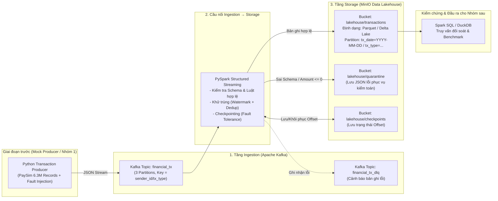

# KẾ HOẠCH TRIỂN KHAI ĐỒ ÁN NHẬP MÔN DỮ LIỆU LỚN (BIG DATA)

- **Giai đoạn lựa chọn trong Pipeline:** `Ingestion → Storage`
- **Tên đề tài:** Thiết kế và triển khai quy trình tiếp nhận (Ingestion) và lưu trữ phân tán (Data Lakehouse Storage) cho luồng dữ liệu giao dịch thanh toán tài chính thời gian thực.
- **Quy mô nhóm:** 04 Thành viên
- **Tài liệu tham chiếu:** `Yêu cầu đồ án.docx.pdf`

---

## 1. Tổng quan Bài toán & Lý do cần Kiến trúc Big Data (Mục 5.1 & 5.2)

### 1.1. Bối cảnh bài toán
Trong các hệ thống ngân hàng số, ví điện tử và cổng thanh toán, hàng triệu giao dịch (`TRANSFER`, `PAYMENT`, `CASH_OUT`, `CASH_IN`, `DEBIT`) phát sinh liên tục 24/7 từ ứng dụng di động, web và máy POS. Hệ thống cần một quy trình **Ingestion → Storage** có khả năng tiếp nhận luồng sự kiện tốc độ cao và tổ chức lưu trữ bền vững vào Data Lake để phục vụ đối soát, kiểm toán và phát hiện gian lận ở các giai đoạn sau (`Storage → Processing → Analytics`).

### 1.2. Đặc trưng Dữ liệu lớn (5V) được giải quyết trong đồ án
1. **Velocity (Tốc độ cao):** Dữ liệu giao dịch sinh ra theo thời gian thực với tần suất hàng nghìn bản ghi/giây, có hiện tượng tăng đột biến (burst traffic) vào giờ cao điểm. Cần **Apache Kafka** làm bộ đệm phân tán (distributed buffer) kết hợp xử lý micro-batch.
2. **Veracity (Độ tin cậy & Toàn vẹn dữ liệu):** Dữ liệu tài chính không được phép mất mát, không được nhân đôi (duplicate) khi mạng lỗi, và phải lọc tách các bản ghi lỗi schema/dữ liệu dị biệt (`amount <= 0`, thiếu mã giao dịch) vào vùng cách ly (**Quarantine / Dead Letter Queue**).
3. **Volume (Khối lượng lớn):** Dữ liệu tích lũy hàng triệu bản ghi mỗi ngày. Lưu trữ dạng văn bản (CSV/JSON) gây tốn dung lượng và chậm khi quét dữ liệu. Cần lưu trữ dạng cột nén (**Apache Parquet / Delta Lake**) kết hợp **Partitioning** trên **MinIO (S3-compatible Data Lake)**.

### 1.3. Ranh giới quy trình (Pipeline Boundary)
- **Điểm bắt đầu (Input):** Nhận sự kiện giao dịch từ Producer giả lập thời gian thực (phát lại từ bộ dữ liệu *PaySim Synthetic Financial Dataset* ~6,3 triệu bản ghi hoặc dữ liệu giao dịch thẻ tín dụng) đẩy vào cụm **Apache Kafka**.
- **Điểm kết thúc (Output):** Dữ liệu sạch, đã khử trùng và chuẩn hóa schema được lưu trữ phân vùng (`tx_date` / `tx_type`) dưới định dạng **Parquet / Delta Lake** trên **MinIO**, sẵn sàng cho nhóm `Storage → Processing` đọc trực tiếp qua giao thức `s3a://`.

---

## 2. Kiến trúc Hệ thống & Bộ Công nghệ (Mục 5.5 & 5.6)

### 2.1. Sơ đồ luồng dữ liệu (Data-Flow Architecture)



### 2.2. Giải thích lựa chọn công nghệ
| Thành phần | Công nghệ lựa chọn | Vai trò & Lý do lựa chọn trong kiến trúc |
| :--- | :--- | :--- |
| **Ingestion Broker** | **Apache Kafka (KRaft mode)** + **Kafka UI** | Tiếp nhận luồng giao dịch thông lượng cao, chia tải qua nhiều Partition, lưu giữ message an toàn trước khi ghi xuống đĩa. |
| **Ingestion → Storage Engine** | **PySpark Structured Streaming** | Đọc luồng từ Kafka, kiểm tra schema, khử trùng lặp (`dropDuplicates` với Watermark), định tuyến bản ghi lỗi và gom micro-batch chống lỗi *Small Files*. |
| **Data Lake Storage** | **MinIO (S3-Compatible Object Storage)** | Hệ thống lưu trữ đối tượng phân tán chuẩn S3, dễ mở rộng dung lượng, tích hợp trực tiếp với hệ sinh thái Spark/Hadoop qua giao thức `s3a://`. |
| **Định dạng lưu trữ** | **Apache Parquet / Delta Lake (Snappy)** | Lưu trữ hướng cột (columnar) giúp nén dung lượng từ 70–85%, hỗ trợ *Predicate Pushdown*, *Partition Pruning* và giao dịch ACID (với Delta Lake). |
| **Truy vấn kiểm chứng** | **DuckDB / Spark SQL** | Truy vấn trực tiếp dữ liệu đã lưu trên MinIO để chứng minh tính đúng đắn, đo tốc độ truy vấn theo partition và bàn giao cho giai đoạn sau. |
| **Đóng gói & Tái lập** | **Docker & Docker Compose** | Đảm bảo 100% khả năng tái lập môi trường trên mọi máy tính chấm bài chỉ với một lệnh `docker compose up -d`. |

---

## 3. Thiết kế Data Contract: Input & Output (Mục 5.3 & 5.4)

### 3.1. Input Schema (JSON Message trên Kafka Topic `financial_tx`)
- **Định dạng:** JSON (UTF-8)
- **Partition Key:** `tx_type` hoặc `sender_id`
- **Cấu trúc trường dữ liệu:**

| Tên trường | Kiểu dữ liệu | Mô tả | Ràng buộc (Validation Rule) |
| :--- | :--- | :--- | :--- |
| `transaction_id` | `STRING` | Mã định danh duy nhất của giao dịch | Bắt buộc (`NOT NULL`), duy nhất |
| `event_time` | `STRING (ISO-8601)` | Thời điểm phát sinh giao dịch | Bắt buộc, định dạng chuẩn Timestamp |
| `step` | `INTEGER` | Bước thời gian mô phỏng (từ bộ PaySim) | `>= 1` |
| `tx_type` | `STRING` | Loại giao dịch (`PAYMENT`, `TRANSFER`, `CASH_OUT`, `CASH_IN`, `DEBIT`) | Bắt buộc, thuộc tập danh mục chuẩn |
| `amount` | `DOUBLE` | Số tiền giao dịch | Bắt buộc, `amount > 0` |
| `currency` | `STRING` | Đơn vị tiền tệ (`VND`, `USD`) | Mặc định `VND` hoặc `USD` |
| `sender_id` | `STRING` | Mã tài khoản người gửi (`nameOrig`) | Bắt buộc (`NOT NULL`) |
| `sender_old_balance` | `DOUBLE` | Số dư trước giao dịch của người gửi | `>= 0` |
| `sender_new_balance` | `DOUBLE` | Số dư sau giao dịch của người gửi | `>= 0` |
| `receiver_id` | `STRING` | Mã tài khoản người nhận (`nameDest`) | Bắt buộc (`NOT NULL`) |
| `payment_channel` | `STRING` | Kênh giao dịch (`MOBILE_APP`, `WEB`, `POS`, `ATM`) | Bắt buộc |
| `is_fraud_label` | `INTEGER` | Nhãn thực tế từ bộ dữ liệu gốc (`0` hoặc `1`) | Phục vụ nhóm Analytics sau này |

**Ví dụ bản ghi Input JSON:**
```json
{
  "transaction_id": "TXN-20261109-00084921",
  "event_time": "2026-11-09T14:22:05.120Z",
  "step": 1,
  "tx_type": "TRANSFER",
  "amount": 1540000.0,
  "currency": "VND",
  "sender_id": "C109382619",
  "sender_old_balance": 5000000.0,
  "sender_new_balance": 3460000.0,
  "receiver_id": "C992817261",
  "payment_channel": "MOBILE_APP",
  "is_fraud_label": 0
}
```

### 3.2. Output Schema & Cấu trúc Lưu trữ trên MinIO (Data Lake)
- **Định dạng file:** Apache Parquet / Delta Lake (nén `Snappy`).
- **Các cột bổ sung tại tầng Storage (Metadata Audit Columns):**
  - `tx_date` (`DATE` - trích xuất từ `event_time`, dùng làm khóa Partition cấp 1).
  - `ingested_at` (`TIMESTAMP` - thời điểm hệ thống ghi xuống Data Lake để tính Latency).
  - `kafka_partition` (`INTEGER`) và `kafka_offset` (`LONG`) để truy vết nguồn gốc.
- **Cấu trúc cây thư mục phân vùng trên MinIO:**
```text
s3a://financial-datalake/
├── bronze/
│   └── transactions/
│       ├── _delta_log/                           # (Nếu dùng Delta Lake)
│       ├── tx_date=2026-11-09/
│       │   ├── tx_type=PAYMENT/
│       │   │   └── part-00000-xxx.snappy.parquet
│       │   ├── tx_type=TRANSFER/
│       │   │   └── part-00001-xxx.snappy.parquet
│       │   └── tx_type=CASH_OUT/
│       │       └── part-00002-xxx.snappy.parquet
│       └── tx_date=2026-11-10/
│           └── ...
├── quarantine/
│   └── bad_transactions/                         # Lưu bản ghi lỗi (amount <= 0, lỗi JSON, thiếu ID)
│       └── rejected_date=2026-11-09/
└── checkpoints/
    └── transactions_stream_chk/                  # Lưu trạng thái streaming phục vụ hồi phục lỗi
```

---

## 4. Phân công Nhiệm vụ Chi tiết cho 4 Thành viên

### Thành viên 1: Kỹ sư Hạ tầng & Kafka Ingestion (Infra & Ingestion Lead - Nhóm trưởng)
- **Trách nhiệm kỹ thuật:**
  1. Thiết lập `docker-compose.yml` và `.env` cho toàn bộ hệ thống (Kafka KRaft, Kafka UI, MinIO, Spark).
  2. Khởi tạo Kafka Topics (`financial_tx` với 3 Partitions, `financial_tx_dlq` với 1 Partition) và giải thích cơ chế phân mảnh theo Partition Key.
  3. Xây dựng `src/producer/transaction_producer.py`:
     - Đọc dữ liệu từ CSV lớn (PaySim) hoặc sinh dữ liệu giao dịch theo luồng.
     - Cho phép cấu hình tốc độ gửi (`--rate 1000`, `5000`, `10000` msg/s).
     - Tích hợp tính năng **Fault/Duplicate Injection** (cố tình chèn ~1–2% bản ghi lỗi `amount < 0`, JSON hỏng, hoặc gửi lặp `transaction_id`) để kiểm chứng khả năng xử lý Veracity của hệ thống.
- **Sản phẩm bàn giao:**
  - `docker-compose.yml`, script tạo topic, `transaction_producer.py`.
  - Ảnh chụp & log từ Kafka UI chứng minh tốc độ nhận dữ liệu và phân bổ đều qua 3 Partitions.

### Thành viên 2: Kỹ sư Luồng đồng bộ & Kiểm soát Chất lượng (Streaming & Reliability Engineer)
- **Trách nhiệm kỹ thuật:**
  1. Xây dựng `src/ingestion_sink/spark_kafka_to_lake.py` sử dụng **PySpark Structured Streaming**.
  2. Xử lý dữ liệu trên luồng trước khi lưu:
     - Parse JSON từ Kafka, đối chiếu với Schema chuẩn.
     - Tách luồng (Branching):
       - **Luồng hợp lệ:** Đầy đủ trường bắt buộc, `amount > 0` $\rightarrow$ thực hiện khử trùng lặp (`withWatermark("event_time", "10 minutes").dropDuplicates(["transaction_id"])`).
       - **Luồng cách ly (Quarantine/DLQ):** Bản ghi sai schema, thiếu khóa hoặc `amount <= 0` $\rightarrow$ gắn nhãn lý do lỗi (`error_reason`) và ghi vào `s3a://financial-datalake/quarantine/`.
  3. Cấu hình cơ chế **Checkpointing** và điều chỉnh `trigger(processingTime='10 seconds')` + `maxOffsetsPerTrigger` để kiểm soát kích thước file ghi xuống Storage.
- **Sản phẩm bàn giao:**
  - Mã nguồn `spark_kafka_to_lake.py`, cấu hình kết nối Spark – Kafka – MinIO.
  - Log vận hành Spark Streaming và minh chứng khôi phục sau sự cố (tắt ngang container rồi bật lại không mất/trùng dữ liệu).

### Thành viên 3: Kiến trúc sư Lưu trữ Data Lakehouse (Storage & Data Lake Architect)
- **Trách nhiệm kỹ thuật:**
  1. Xây dựng `src/storage_management/init_minio_buckets.py` tự động tạo bucket `financial-datalake` và cấu hình quyền truy cập.
  2. Thiết kế và tối ưu tầng lưu trữ **Parquet / Delta Lake** phân vùng theo `tx_date` và `tx_type`.
  3. Xây dựng `src/storage_management/compact_small_files.py`: Giải quyết bài toán **Small Files Problem** trong streaming bằng cách gộp các file Parquet nhỏ trong từng partition thành file chuẩn (hoặc dùng `OPTIMIZE` của Delta Lake).
  4. Xây dựng `src/storage_management/query_verification.py`: Sử dụng **DuckDB / Spark SQL** truy vấn trực tiếp dữ liệu từ MinIO để đối soát tổng số bản ghi, tổng giá trị giao dịch theo ngày/kênh và xuất dữ liệu mẫu cho nhóm sau.
- **Sản phẩm bàn giao:**
  - Các script quản lý Storage, Compaction và truy vấn SQL kiểm chứng.
  - Ảnh chụp giao diện MinIO Console thể hiện rõ cây thư mục Partition và các file `.snappy.parquet`.

### Thành viên 4: Kỹ sư Thực nghiệm, Benchmark & Đảm bảo chất lượng (Benchmark & QA Lead)
- **Trách nhiệm kỹ thuật:**
  1. Xây dựng `src/benchmark/run_benchmarks.py` và chạy **04 Kịch bản Thực nghiệm** bắt buộc để lấy số liệu và vẽ biểu đồ (Matplotlib/Seaborn):
     - **Thí nghiệm 1 (Throughput & Latency):** Đo thông lượng ghi (records/sec) và độ trễ trung bình khi tăng tốc độ Producer từ `1.000` $\rightarrow$ `5.000` $\rightarrow$ `10.000` msg/s.
     - **Thí nghiệm 2 (Storage Compression Efficiency):** So sánh dung lượng lưu trữ giữa định dạng **Raw CSV**, **Raw JSON** và **Parquet/Delta (Snappy)** trên cùng 500.000 – 1.000.000 bản ghi.
     - **Thí nghiệm 3 (Partition Pruning Speedup):** Đo thời gian thực thi truy vấn lọc theo `tx_date` và `tx_type` giữa bảng **Không phân vùng (Unpartitioned)** và bảng **Có phân vùng (Partitioned)** + trước/sau khi chạy **Compaction**.
     - **Thí nghiệm 4 (Veracity & Fault Tolerance):** Kiểm chứng độ chính xác đối soát: Bơm `100.000` bản ghi (gồm `98.000` hợp lệ, `1.000` bản ghi trùng lặp, `1.000` bản ghi lỗi `amount < 0`), chứng minh Storage lưu đúng `98.000` bản ghi sạch và Quarantine lưu đúng `1.000` bản ghi lỗi.
  2. Biên soạn `README.md` hướng dẫn cài đặt và chạy lại toàn bộ đồ án từng bước (Reproducibility - Mục 5.8).
- **Sản phẩm bàn giao:**
  - Script benchmark, bảng số liệu CSV, các biểu đồ so sánh (`.png`), tập ảnh chụp demo và file `README.md`.

---

## 5. Lộ trình Thực hiện theo 4 Giai đoạn (Timeline)

| Giai đoạn | Thời lượng dự kiến | Công việc trọng tâm | Tiêu chí hoàn thành (Milestone) |
| :--- | :---: | :--- | :--- |
| **Giai đoạn 1: Khởi tạo & Chốt Thiết kế** | 2 – 3 ngày | - Tải bộ dữ liệu PaySim / tạo dữ liệu mẫu.<br/>- Chốt Data Contract (Input/Output Schema).<br/>- TV1 dựng xong `docker-compose.yml` chạy lên được Kafka + MinIO. | Mọi thành viên chạy `docker compose up -d` thành công trên máy cá nhân. |
| **Giai đoạn 2: Xây dựng Luồng cơ bản (MVP)** | 4 – 5 ngày | - TV1 hoàn thiện Producer đẩy 10.000 dòng thử nghiệm.<br/>- TV2 viết xong Spark Streaming đọc Kafka ghi xuống MinIO.<br/>- TV3 cấu hình xong Partition `tx_date/tx_type` và chạy truy vấn DuckDB/Spark SQL đọc lại thành công. | Dữ liệu đi thông suốt từ Producer $\rightarrow$ Kafka $\rightarrow$ Spark $\rightarrow$ MinIO (Parquet) và truy vấn SQL ra kết quả đúng. |
| **Giai đoạn 3: Nâng cấp Kỹ thuật & Benchmark** | 4 – 5 ngày | - TV2 bổ sung lọc Quarantine (DLQ), khử trùng (Dedup) và Checkpoint.<br/>- TV3 bổ sung script gộp file nhỏ (Compaction).<br/>- TV4 phối hợp chạy 4 kịch bản thực nghiệm trên tập dữ liệu lớn (500K – 2M+ dòng), vẽ biểu đồ. | Có đầy đủ bảng số liệu, biểu đồ, ảnh chụp màn hình và log chứng minh 4 kịch bản thực nghiệm. |
| **Giai đoạn 4: Viết Báo cáo & Đóng gói** | 3 – 4 ngày | - 4 thành viên viết báo cáo theo mục phân công (~30 trang A4).<br/>- Kiểm tra chéo `README.md` trên máy sạch.<br/>- Chuẩn bị slide và kịch bản chạy live demo. | Hoàn thiện file PDF Báo cáo, source code sạch đẹp và sẵn sàng bảo vệ. |

---

## 6. Phân công Viết Báo cáo Đồ án (~30 Trang A4 - Khớp Mục 6.1 & 6.2)

| Chương / Mục trong Báo cáo | Thành viên phụ trách | Nội dung chi tiết cần trình bày | Số trang dự kiến |
| :--- | :---: | :--- | :---: |
| **Trang bìa, Tóm tắt, Mục lục** | **TV1** | Tên đề tài, danh sách nhóm, bảng phân công đóng góp, tóm tắt 150–250 từ. | 2 trang |
| **Chương 1: Giới thiệu** | **TV1** | Bối cảnh giao dịch tài chính số, mục tiêu đề tài, phạm vi giai đoạn `Ingestion → Storage`, các câu hỏi kỹ thuật cần giải quyết. | 3 trang |
| **Chương 2: Cơ sở lý thuyết và Công nghệ liên quan** | **TV2 & TV3** | - **TV2:** Kiến trúc Apache Kafka (Topic, Partition, Offset, Consumer Group), cơ chế Streaming Ingestion, Checkpointing & ngữ nghĩa Exactly-once.<br/>- **TV3:** Kiến trúc Data Lake / Lakehouse, Object Storage (MinIO/S3), định dạng lưu trữ cột Apache Parquet / Delta Lake, kỹ thuật Partitioning & bài toán Small Files. | 6 trang |
| **Chương 3: Dữ liệu và Yêu cầu** | **TV1 & TV3** | - **TV1:** Mô tả bộ dữ liệu giao dịch tài chính, phân tích 3 đặc trưng Volume, Velocity, Veracity; đặc tả Input Schema & ví dụ bản ghi.<br/>- **TV3:** Đặc tả Output Schema, cấu trúc Partition, Data Contract bàn giao cho giai đoạn `Storage → Processing`. | 4 trang |
| **Chương 4: Thiết kế Hệ thống** | **TV3 (chính) & TV2** | Sơ đồ kiến trúc tổng thể, sơ đồ luồng dữ liệu (Data-flow), thiết kế phân vùng lưu trữ, cơ chế tách luồng dữ liệu sạch và vùng cách ly (Quarantine), lý giải các quyết định chọn công nghệ. | 4 trang |
| **Chương 5: Cài đặt và Triển khai** | **TV2 (chính) & TV1** | Thiết lập môi trường Docker Compose, cấu hình Kafka Broker/Topics, chi tiết triển khai Producer, job PySpark Structured Streaming, xử lý lỗi/khử trùng và script Compaction. | 5 trang |
| **Chương 6: Thực nghiệm và Đánh giá** | **TV4** | Trình bày môi trường test, 04 kịch bản thực nghiệm (Throughput/Latency, Độ nén CSV/JSON vs Parquet, Partition Pruning, Kiểm thử chịu lỗi/Veracity), bảng số liệu và biểu đồ phân tích. | 4 trang |
| **Chương 7: Kết quả Demo** | **TV4** | Mô tả kịch bản chạy demo từ đầu đến cuối kèm ảnh chụp màn hình: Terminal Producer, Kafka UI, Spark Streaming UI, MinIO Console, và kết quả truy vấn SQL đối soát. | 3 trang |
| **Chương 8 & 9: Thảo luận và Kết luận** | **TV4 & Cả nhóm** | Điểm mạnh, hạn chế thực tế của hệ thống, bài học kỹ thuật rút ra, hướng mở rộng (kết nối nhóm sau, nâng cấp cụm đa node). | 2 trang |
| **Tài liệu tham khảo & Phụ lục** | **Cả nhóm** | Trích dẫn tài liệu chuẩn, hướng dẫn chạy nhanh (`README`), cấu hình chính, khai báo sử dụng công cụ hỗ trợ (nếu có). | Phụ lục |

---

## 7. Cấu trúc Thư mục Mã nguồn Dự kiến (Mục 5.8 & Mục 7)

```text
D:\DuLieuLon\
├── plan.md                              # Bản kế hoạch tổng thể này
├── docker-compose.yml                   # (TV1) Khởi tạo Kafka, Kafka-UI, MinIO, Spark
├── .env                                 # (TV1) Cấu hình biến môi trường
├── requirements.txt                     # Thư viện Python (confluent-kafka, pyspark, duckdb, minio, matplotlib...)
├── src/
│   ├── producer/
│   │   └── transaction_producer.py      # (TV1) Phát luồng giao dịch + giả lập lỗi/trùng lặp
│   ├── ingestion_sink/
│   │   └── spark_kafka_to_lake.py       # (TV2) PySpark Streaming: Kafka -> Validate/Dedup -> MinIO Parquet
│   ├── storage_management/
│   │   ├── init_minio_buckets.py        # (TV3) Tạo bucket và kiểm tra kết nối S3/MinIO
│   │   ├── compact_small_files.py       # (TV3) Gộp các file Parquet nhỏ trong từng Partition
│   │   └── query_verification.py        # (TV3) Truy vấn SQL kiểm chứng dữ liệu đã lưu trên Data Lake
│   └── benchmark/
│       └── run_benchmarks.py            # (TV4) Chạy 4 kịch bản thực nghiệm & xuất biểu đồ đánh giá
├── data/
│   └── sample_transactions.csv          # Tập dữ liệu mẫu đi kèm để người chấm chạy thử ngay
├── docs/
│   ├── charts/                          # (TV4) Biểu đồ kết quả thực nghiệm
│   └── screenshots/                     # (TV4) Ảnh chụp màn hình minh chứng hoạt động
└── README.md                            # (TV4) Hướng dẫn cài đặt và chạy kiểm chứng từng bước
```
